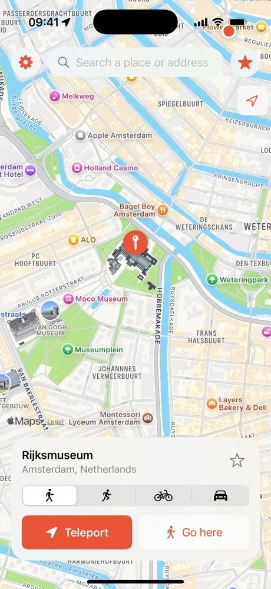
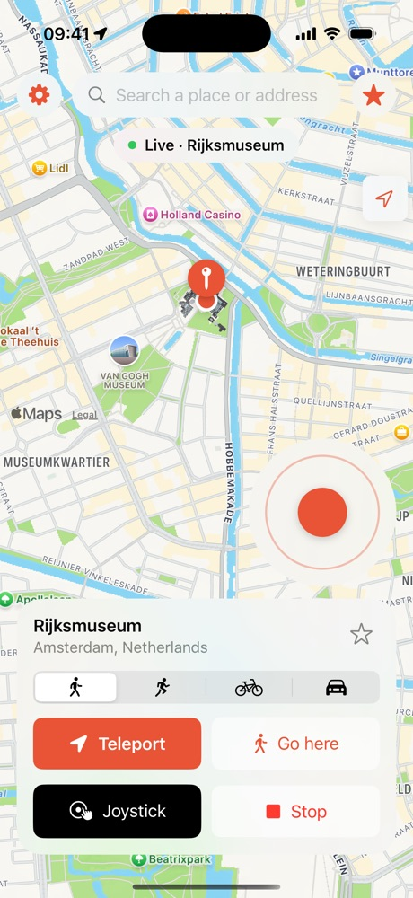
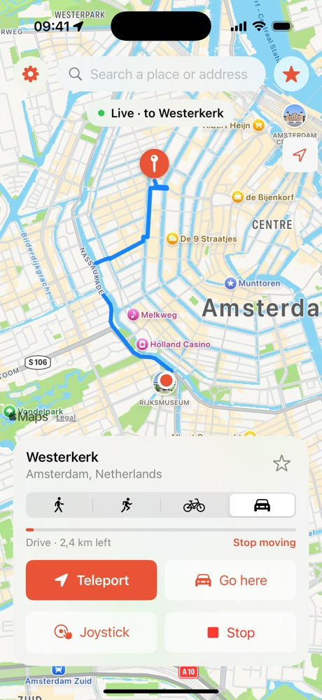
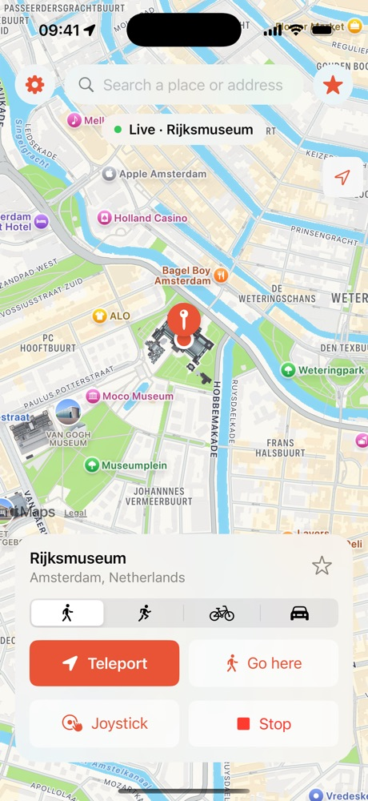

<p align="center">
  
</p>

<h1 align="center">Roam for SideStore</h1>

<p align="center">
  Move your iPhone's location for every app at once.<br>
  <a href="https://roamlocation.com">roamlocation.com</a>
</p>

---

Roam changes where your iPhone thinks it is: Maps, Find My, Weather, the App Store and every other app see the new place. It uses Apple's own developer location service (the one Xcode uses), so there's no jailbreak.

This repository is only the install page for the SideStore/AltStore version. The app itself isn't open source.

<p align="center">
  
  
  
  
</p>

## Source

Add this source in SideStore or AltStore:

```
https://roamlocation.com/source.json
```

SideStore › **Sources** › **+** › paste the link › **Roam** › **Free**.

> Opening the link in a browser shows raw JSON. That's normal: it's a file for SideStore, not a web page.

## What you need

- An iPhone with **iOS 27 or newer**. Older iOS versions don't work.
- **Developer Mode** on (Settings › Privacy & Security › Developer Mode).
- [SideStore](https://sidestore.io) with your own Apple ID (a free one works).
- The free **LocalDevVPN** app from the App Store.

## Install

1. Install SideStore with iloader on a computer (once). See [sidestore.io](https://sidestore.io).
2. Turn on **Developer Mode** and restart.
3. Open **LocalDevVPN** and tap **Connect**.
4. In SideStore, add the source above and install **Roam**.
5. Open Roam and follow the setup: start your free trial, pair with your iPhone, turn on LocalDevVPN and allow location.

A step-by-step guide with pictures is on [roamlocation.com](https://roamlocation.com).

## Free trial and passes

Roam starts with a **free 3-day trial**, no card needed. After that you pick a pass inside Roam: a day, a week, a month or a year. You pay on roamlocation.com and Roam picks it up by itself. If Roam doesn't work on your iPhone within 7 days, you get your money back.

## Every 7 days

With a free Apple ID, sideloaded apps last 7 days. Keep LocalDevVPN connected and SideStore refreshes Roam in the background, or open SideStore › **My Apps** › **Refresh All**.

Don't want to refresh, or no computer? Get Roam the easy way on [roamlocation.com](https://roamlocation.com): installed from your own link and valid for a year.

## Good to know

- iOS marks the location as simulated. Some apps and games forbid changed locations; don't use Roam there.
- Your places stay on your iPhone. Roam doesn't track you.
- Not affiliated with Apple, SideStore or AltStore.

## Support

Chat with us on [roamlocation.com](https://roamlocation.com) or e-mail support@roamlocation.com.

## Credits

Roam is based on and uses code from these projects, with thanks:

- [Locus](https://github.com/ChrisMack32/Locus) (MIT): parts of the location engine.
- [idevice](https://github.com/jkcoxson/idevice) by Jackson Coxson (MIT): talking to the iPhone's developer services.
- [StosVPN](https://github.com/SideStore/StosVPN) by the SideStore Team: the loopback VPN technique.

© BLOCC
